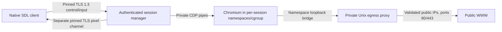

# WolfTunnel v0.5 architecture

The client renders trusted native controls and remote image textures. The node
executes the webpage. Web content cannot paint the native toolbar, execute local
JavaScript, read a local browser profile or control the host desktop.

## Protocol and authentication

v0/v2 codecs, payload limits, identity files, storage policies and diagnostic
operations remain intact. The TLS listener distinguishes v3 by its independent
identifier; it does not reinterpret a v2 frame. v3 negotiates version 3 for
browser sessions; v2 operations negotiate separately. Browser requests never
silently fall back to metadata fetching.

v3 has a 48-byte big-endian header, bounded strict JSON control messages and
binary JPEG/PNG payloads. Each persistent TLS channel proves possession of the
client's Ed25519 key with a fresh TLS-exporter-bound signature. The proof includes
role and session ID. Both channels verify the same explicit certificate pin.
An unguessable 128-bit session ID grants no authority without authentication.
Subsequent inputs rely on TLS integrity and sequencing rather than new signatures
or connections. See [PROTOCOL-v3.md](docs/PROTOCOL-v3.md).

Ownership, expiry and revocation are checked at creation, attachment and every
command, plus a one-second idle authorisation sweep. Losing either channel
tears down the browser; reconnecting creates fresh state. Existing invitation
and credential lifetimes remain 30 and 90 days respectively. Certificate
rotation still requires explicit owner verification.

## Browser and network boundaries

Each session receives its own Chromium process, off-the-record context, private
profile/tmpfs, isolated state and systemd user scope. Tabs are pages in this
session, not separate top-level process scopes. Background pages are frozen
where supported. Unknown popup targets are closed; CDP operations remain fixed
server methods. There is no generic CDP endpoint or browser-control TCP port.

The launcher requires an application-managed, SHA-256-pinned ELF browser engine, refuses
root and group/world-writable engines, and keeps Chromium's sandbox enabled.
Startup verifies Chromium's namespace and seccomp sandbox through its fixed
internal sandbox report before accepting user navigation. Browser stderr is
bounded during startup and discarded before any user navigation; runtime
console, page text and raw CDP errors never enter application logs.

Bubblewrap provides new user/PID/network/IPC/UTS namespaces, dropped capabilities,
read-only system/runtime resources and no node state, home, DBus, host sockets or
GPU. A private network namespace has no outward network interface. A fixed
loopback bridge can reach only this session's mode-0600 Unix proxy socket in a
mode-0700 temporary directory. This covers scripts, nested frames, redirects,
service workers, WebSockets, browser DNS/UDP attempts and browser subprocesses,
including traffic not visible to address-bar validation. WebRTC has no direct
UDP path. CDP uses inherited local pipes only.

The parent proxy reuses the existing public-address policy. It checks every DNS
answer on every connection, rejects mixed public/private results and dials an
already checked numeric address. It never consults environment proxies. Public
HTTP, HTTPS CONNECT and WebSocket upgrades are supported on ports 80/443.
Loopback/private/link-local/metadata and prohibited schemes/ports fail closed.
Existing tunnels remain pinned to their initial checked public address; later
connections re-resolve and revalidate. HTTPS certificates are checked by
Chromium, without production overrides.

The proxy bounds connections, headers, request sizes, response bytes, tunnel
bytes and deadlines. HTTPS CONNECT payloads are end-to-end opaque to this HTTP
proxy: header/body controls on ordinary HTTP are not an HTTPS content filter.
Uploads of local files are prevented through denied browser file selection and
absence of host files. Downloads, clipboard, password integration, extensions,
microphone and audio are disabled/excluded. Sites can still submit normal forms
and generate their own network data inside the isolated browser.

## Limits and lifecycle

Validated browser defaults:

| Limit | Default |
|---|---:|
| Sessions: global / per client | 2 / 1 |
| Tabs per session | 4 |
| Memory per scope / reserved aggregate | 1024 / 2048 MiB |
| CPU quota / tasks per scope | 150% / 384 |
| Profile/tmpfs / shared-memory tmpfs | 192 / 64 MiB |
| Maximum viewport | 1920×1200, 2,304,000 pixels |
| Capture rate / JPEG quality | 15 fps / 82 |
| Pixel bandwidth | 4 MiB/s per session |
| Control / pixel frame hard caps | 64 KiB / 8 MiB |
| Full-refresh interval | 2 seconds |
| Startup / navigation / idle | 20 s / 20 s / 2 min |
| CDP pending calls / event queue | 32 / 128 |
| Client urgent inputs / latest movement | 128 / 1 |
| Node control responses / latest image | 32 / 1 |
| Client displayed-frame queue | 1 |

The aggregate memory value is a reservation bound: maximum sessions × per-session
hard limit cannot exceed it. systemd enforces memory/no-swap, CPU, tasks and a
30-minute maximum session runtime. Browser work has context deadlines; blocked
CDP writes also terminate on deadline. Session shutdown closes both transports,
stops only its scope with a three-second bound, cancels work, reaps processes and
removes the proxy directory. Node shutdown waits for handlers.

`-browser-config` overlays validated defaults using private strict JSON; duration
fields are integer nanoseconds. `max_frame_bytes` can lower the absolute 8 MiB
cap; `refresh` is configurable between 100 ms and 10 seconds. Operators can raise
viewport limits to 3840×2160 within hard pixel/memory caps after profiling.
Low limits may prevent Chromium starting; failure never enables a weaker sandbox.

## Pixels, input and native UI

The first requested logical viewport defaults to 1920×1080, DPR 1. Native window
content dimensions subsequently drive the remote viewport, excluding trusted
controls/status. The 1920×1200 preset is within default limits. Resize events
coalesce over 100 ms, update the existing browser, receive an acknowledgement and
force a complete refresh. Letterboxing has an inverse CSS-coordinate mapping.
High-DPI native text remains rendered at the native output scale.

CDP captures the selected webpage viewport as quality-controlled JPEG. Equal
captures are hash-suppressed between configurable full refreshes. Every sent
frame is independent and includes tab, dimensions, sequence, capture timestamp
and last applied input sequence. No public visual payload is base64 JSON. The
browser's private CDP pipe internally uses its mandated base64 screenshot field.
Capture/resize selection locks keep image and metadata dimensions consistent.

Node and client queues replace obsolete images with the newest complete image.
The pixel writer has independent bandwidth pacing/deadlines. Slow visual
consumption cannot put input behind pixels on the control connection. Movement
coalesces; key/button/text/wheel events preserve urgent ordering. Overflow closes
the session rather than losing a release. Blur, tab changes and closure release
held keys/buttons. Physical key events and committed Unicode text are separate;
Enter includes Chromium's character semantics for ordinary form submission.

Binary decoders validate sizes and JPEG/PNG dimensions before allocating image
surfaces. Textures are bounded and updated on the SDL thread; page pixels are
clipped to the webpage viewport. Native tab selection also selects the node page.
Only encrypted navigation status supplies the current remote address; it is
rendered as text and never logged. Explicit `-metadata` preserves the v2 UI.

## Packages and diagnostics

| Component | Responsibility |
|---|---|
| `internal/protocol/v3` | Header, strict schemas, proofs, bounded decoding |
| `internal/session` | Ownership, dual channels, auth sweep, queues, capture scheduling |
| `internal/browser` | Linux isolation, scoped CDP, tabs, input, capture, process limits |
| `internal/browsernet` | Per-session validating egress proxy and socket limits |
| `internal/pixelstream` | Binary metadata and bounded image validation/decode |
| `internal/nodeclient` | Pinned channels, persistent RPC, event/frame queues, measurements |
| `frontend/input.go`, `viewport.go`, `remote.go` | SDL coordinates/textures, input, remote model lifecycle |
| Existing auth/identity/storage/audit/fetch | Preserved v0.2 foundations |

Audit logs record authenticated channels, session creation/closure, fixed failure
categories, session/client IDs, duration and aggregate pixel/drop counters. They
omit URLs, input, screenshots, cookies, console and bodies. Existing v2 logs may
include destination hosts but omit paths and queries. Files rotate at 1 MiB,
seven-day retention by default, maximum 64 files; protected backups may outlive
retention. Capture artifacts exist only through explicit capture/test requests.

See [THREAT_MODEL-v0_5.md](docs/THREAT_MODEL-v0_5.md) and the
[validation report](docs/USABILITY-2026_10_25.md) for tested boundaries
and remaining limits. Audio, file transfer, clipboard sync, accessibility and
production packaging need separate work.

## Managed runtime and saved defaults

The usability update provisions a pinned Chrome for Testing runtime under node
state or reads a verified `renderer/` bundle beside the node executable. It never
searches for a system Chromium/Brave installation. The build embeds a versioned
archive/executable/per-file hash manifest; downloads use the fixed HTTPS source,
size caps, an install lock, traversal/symlink rejection, complete hash validation
and atomic publication. Existing corrupted runtimes fail closed. This is an
application-private/bundled engine, not a statically linked Go HTML renderer;
Linux system libraries, bubblewrap and user systemd/cgroups remain required.

New defaults use XDG data directories (`~/.local/share/wolftunnel/node` and
`client`). Explicit XDG selection overrides legacy discovery; without it,
existing default identities remain in place. Node `settings.json` remembers the
listener/public invitation address and renderer preferences; `browser.json` is
created automatically. Client defaults and credentials are saved automatically.
Browser settings start with 384 tasks to accommodate the managed runtime.

Default client logs also have the stable `~/.local/share/wolftunnel/logs/client.log`
path, rotated at 1 MiB with three backups, alongside existing audit files.
Handled startup, settings, connection, enrolment and browser failures include
fixed codes and safe explanations; typed network causes preserve refused/timeout/
DNS diagnosis without raw input or arbitrary peer error messages. Custom client
state keeps its logs beneath that state directory. See [SETUP.md](SETUP.md).
