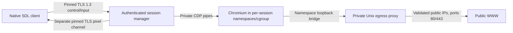

# WolfTunnel v0.6.x architecture

The client renders trusted native controls and remote image textures. The node
executes the webpage. Web content cannot paint the native toolbar, execute local
JavaScript, read a local browser profile or control the host desktop.

## Protocol and authentication

v0/v2 codecs, payload limits, identity files, storage policies and diagnostic
operations remain intact. The TLS listener distinguishes v3 by its independent
identifier; it does not reinterpret a v2 frame. v3 negotiates version 3 for
browser sessions; v2 operations negotiate separately. Browser requests never
silently fall back to metadata fetching.

v3 has a 48-byte big-endian header, bounded strict JSON control messages and
binary JPEG/PNG payloads. Each persistent TLS channel proves possession of the
client's Ed25519 key with a fresh TLS-exporter-bound signature. The proof includes
role and session ID. Both channels verify the same explicit certificate pin.
An unguessable 128-bit session ID grants no authority without authentication.
Subsequent inputs rely on TLS integrity and sequencing rather than new signatures
or connections. See [PROTOCOL-v3.md](docs/PROTOCOL-v3.md).

Ownership, expiry and revocation are checked at creation, attachment and every
command, plus a one-second idle authorisation sweep. Losing either channel
tears down the browser; reconnecting creates fresh state. Existing invitation
and credential lifetimes remain 30 and 90 days respectively. Certificate
rotation still requires explicit owner verification.

## Connection establishment and supported transports

`internal/transport.Connector` returns a TLS stream; application framing and
Ed25519 authorization remain in nodeclient/protocol. One connector serves v2
setup/diagnostics and both v3 roles. A second check at the application boundary
requires a completed TLS 1.3 handshake, the configured leaf SHA-256 pin and valid
certificate dates regardless of the connector implementation.

`tls-tcp` resolves and connects directly. `http-connect` resolves/connects only
the explicitly configured HTTP(S) proxy, requests CONNECT for the node authority,
and runs the same pinned node TLS inside the tunnel. HTTPS proxies first require
ordinary system-root/hostname validation (TLS >=1.2). CONNECT does not convert
Wolf frames to HTTP requests or disguise their purpose. Both roles still use
distinct TCP connections to the same node listener, default 13300. This retains
existing deployments; a separate frame listener adds no tested benefit here.

Transport defaults: 20-second overall connection budget; DNS, TCP, CONNECT and
TLS stages each at most five seconds within that budget; two establishment
retries (three total tries), validated range zero to three. Delay starts at
200 ms and doubles with 0.8–1.2 jitter. Only transient establishment failures
retry. Identity failures, denied/auth-required proxies, protocol, authorization
and browser actions do not retry or replay. Browser startup retains a bounded
90-second orchestration budget for the configurable node startup/result/attach
path. Display establishment is capped at 25 seconds, while the node allows
30 seconds for attachment (20 seconds transport + protocol/scheduling margin).
The old five-second node wait was shorter than permitted client connection work
and could destroy a ready browser before attachment. No-frame waiting starts
only when the first page is requested, with a separate 15-second first-frame
deadline. Normal channel writes remain five seconds; control/pixel reads are bounded
at 30/15 seconds. Losing a channel ends the disposable session. Reconnection
uses saved installation credentials and creates a new browser; no page action
is silently replayed.

Attempt records contain a random correlation ID, role, selected transport, state,
failure checkpoint, retry number and elapsed milliseconds. UI progress uses a
bounded generation-filtered channel, separate from worker completions. DNS,
TCP refusal/timeout, proxy, TLS, pin, negotiation, authorization, startup and
stream failures have distinct safe explanations. Proxy responses/bodies and
arbitrary network errors never become log text. Logs do not diagnose a specific
filter vendor from a timeout alone.

No PAC/environment proxy discovery, proxy authentication, SOCKS, XVPN, VPN,
WebSocket camouflage, HTTP/2 or protocol fallback is implemented. Proxy URLs
cannot contain credentials, paths, queries or fragments; CONNECT response headers
are bounded to 16 KiB, 64 lines and 4 KiB per line. The configured tunnel must be
approved by its network operator. An inspecting replacement certificate fails
the node pin; adding an inspection root cannot change that property.

## Browser and network boundaries

Each session receives its own Chromium process, off-the-record context, private
profile/tmpfs, isolated state and systemd user scope. Tabs are pages in this
session, not separate top-level process scopes. Background pages are frozen
where supported. Chromium-created popup targets are closed. Capable clients receive validated
user-gesture new-window destinations through the regular Wolf tab manager;
unprompted/invalid requests get an explicit rejection. CDP operations remain fixed
server methods. There is no generic CDP endpoint or browser-control TCP port.

The launcher requires an application-managed, SHA-256-pinned ELF browser engine, refuses
root and group/world-writable engines, and keeps Chromium's sandbox enabled.
Startup verifies Chromium's namespace and seccomp sandbox through its fixed
internal sandbox report before accepting user navigation. Browser stderr is
bounded during startup and discarded before any user navigation; runtime
console, page text and raw CDP errors never enter application logs.

Bubblewrap provides new user/PID/network/IPC/UTS namespaces, dropped capabilities,
read-only system/runtime resources and no node state, home, DBus, host sockets or
GPU. A private network namespace has no outward network interface. A fixed
loopback bridge can reach only this session's mode-0600 Unix proxy socket in a
mode-0700 temporary directory. This covers scripts, nested frames, redirects,
service workers, WebSockets, browser DNS/UDP attempts and browser subprocesses,
including traffic not visible to address-bar validation. WebRTC has no direct
UDP path. CDP uses inherited local pipes only.

The parent proxy reuses the existing public-address policy. It checks every DNS
answer on every connection, rejects mixed public/private results and dials an
already checked numeric address. It never consults environment proxies. Public
HTTP, HTTPS CONNECT and WebSocket upgrades are supported on ports 80/443.
Loopback/private/link-local/metadata and prohibited schemes/ports fail closed.
Existing tunnels remain pinned to their initial checked public address; later
connections re-resolve and revalidate. HTTPS certificates are checked by
Chromium, without production overrides.

The proxy bounds connections, headers, request sizes, response bytes, tunnel
bytes and deadlines. HTTPS CONNECT payloads are end-to-end opaque to this HTTP
proxy: header/body controls on ordinary HTTP are not an HTTPS content filter.
Uploads of local files are prevented through denied browser file selection and
absence of host files. Downloads, clipboard, password integration, extensions,
microphone and audio are disabled/excluded. Sites can still submit normal forms
and generate their own network data inside the isolated browser.

## Limits and lifecycle

Validated browser defaults:

| Limit | Default |
|---|---:|
| Sessions: global / per client | 2 / 1 |
| Tabs per session | 4 |
| Memory per scope / reserved aggregate | 1024 / 2048 MiB |
| CPU quota / tasks per scope | 150% / 384 |
| Profile/tmpfs / shared-memory tmpfs | 192 / 64 MiB |
| Maximum viewport | 1920×1200, 2,304,000 pixels |
| Capture rate / JPEG quality | 15 fps / 82 |
| Pixel bandwidth | 4 MiB/s per session |
| Control / pixel frame hard caps | 64 KiB / 8 MiB |
| Full-refresh interval | 2 seconds |
| Startup / navigation / idle | 20 s / 20 s / 2 min |
| CDP pending calls / event queue | 32 / 128 |
| Client urgent inputs / latest movement | 128 / 1 |
| Node control responses / latest image | 32 / 1 |
| Client displayed-frame queue | 1 |

The aggregate memory value is a reservation bound: maximum sessions × per-session
hard limit cannot exceed it. systemd enforces memory/no-swap, CPU, tasks and a
30-minute maximum session runtime. Browser work has context deadlines; blocked
CDP writes also terminate on deadline. Session shutdown closes both transports,
stops only its scope with a three-second bound, cancels work, reaps processes and
removes the proxy directory. Node shutdown waits for handlers.

`-browser-config` overlays validated defaults using private strict JSON; duration
fields are integer nanoseconds. `max_frame_bytes` can lower the absolute 8 MiB
cap; `refresh` is configurable between 100 ms and 10 seconds. Operators can raise
viewport limits to 3840×2160 within hard pixel/memory caps after profiling.
Low limits may prevent Chromium starting; failure never enables a weaker sandbox.

## Pixels, input and native UI

The first requested logical viewport defaults to 1920×1080, DPR 1. Native window
content dimensions subsequently drive the remote viewport, excluding trusted
controls/status. The 1920×1200 preset is within default limits. Resize events
coalesce over 100 ms, update the existing browser, receive an acknowledgement and
force a complete refresh. Letterboxing has an inverse CSS-coordinate mapping.
High-DPI native text remains rendered at the native output scale. One in-flight resize and one
pending replacement supersede older requests. Acknowledgement gates the next
request and prevents an old A-sized frame completing an A→B→A burst. One blur releases held input before
the burst, and new position-dependent inputs are paused until an image matches
the latest requested size; intermediate acknowledgements/images cannot realign
input to an obsolete frame.

CDP captures the selected webpage viewport as quality-controlled JPEG. Equal
captures are hash-suppressed between configurable full refreshes. Every sent
frame is independent and includes tab, dimensions, sequence, capture timestamp
and last applied input sequence. No public visual payload is base64 JSON. The
browser's private CDP pipe internally uses its mandated base64 screenshot field.
Capture/resize selection locks keep image and metadata dimensions consistent.

Node and client queues replace obsolete images with the newest complete image.
The pixel writer has independent bandwidth pacing/deadlines. Slow visual
consumption cannot put input behind pixels on the control connection. Movement
coalesces; key/button/text/wheel events preserve urgent ordering. Overflow closes
the session rather than losing a release. Blur, tab changes and closure release
held keys/buttons. Physical key events and committed Unicode text are separate;
Enter includes Chromium's character semantics for ordinary form submission.
A pending real movement is flushed before urgent button/key transitions, and
Chromium receives the held button identity during moves, allowing text selection.
Printable SDL key values preserve layout-specific logical keys; committed text
continues through SDL text input. Key repeat and pinch are advertised through
`input-v06`; a new client strips repeat fields/rejects pinch on older nodes.
Fractional horizontal and vertical wheel deltas remain floats. Native pinch
begin/update/end is cancelled by blur, menus, leaving/minimizing the window or
session termination. Relative scale updates use fixed Page.getLayoutMetrics /
Emulation.setPageScaleFactor calls, bounded to 1–5x. This works in desktop
headless Chromium where a synthetic touch pinch acknowledged success without
zooming. Pointer-anchored pan/focal-point preservation is not implemented.

Binary decoders validate sizes and JPEG/PNG dimensions before allocating image
surfaces. Textures are bounded and updated on the SDL thread; page pixels are
clipped to the webpage viewport. Native tab selection also selects the node page.
Only encrypted navigation status supplies the current remote address; it is
rendered as text and never logged. Explicit `-metadata` preserves the v2 UI.

## Packages and diagnostics

| Component | Responsibility |
|---|---|
| `internal/protocol/v3` | Header, strict schemas, proofs, bounded decoding |
| `internal/session` | Ownership, dual channels, auth sweep, queues, capture scheduling |
| `internal/browser` | Linux isolation, scoped CDP, tabs, input, capture, process limits |
| `internal/browsernet` | Per-session validating egress proxy and socket limits |
| `internal/pixelstream` | Binary metadata and bounded image validation/decode |
| `internal/transport` | Explicit direct/CONNECT establishment, deadlines, retry/state diagnostics |
| `internal/nodeclient` | Pinned channels, persistent RPC, event/frame queues, measurements |
| `frontend/input.go`, `viewport.go`, `remote.go` | SDL coordinates/textures, input, remote model lifecycle |
| Existing auth/identity/storage/audit/fetch | Preserved v0.2 foundations |

Audit logs record authenticated channels, session creation/closure, fixed failure
categories, session/client IDs, duration and aggregate pixel/drop counters. They
omit URLs, input, screenshots, cookies, console and bodies. Existing v2 logs may
include destination hosts but omit paths and queries. Files rotate at 1 MiB,
seven-day retention by default, maximum 64 files; protected backups may outlive
retention. Capture artifacts exist only through explicit capture/test requests.

See [THREAT_MODEL-v0_6.md](docs/THREAT_MODEL-v0_6.md) and the
[validation report](doc/IMPLEMENTATION-v0_6_x-2026_10_28.md) for tested boundaries
and remaining limits. Audio, file transfer, clipboard sync, accessibility and
production packaging need separate work.

## Managed runtime and saved defaults

The usability update provisions a pinned Chrome for Testing runtime under node
state or reads a verified `renderer/` bundle beside the node executable. It never
searches for a system Chromium/Brave installation. The build embeds a versioned
archive/executable/per-file hash manifest; downloads use the fixed HTTPS source,
size caps, an install lock, traversal/symlink rejection, complete hash validation
and atomic publication. Existing corrupted runtimes fail closed. This is an
application-private/bundled engine, not a statically linked Go HTML renderer;
Linux system libraries, bubblewrap and user systemd/cgroups remain required.

Linux amd64 and ARM64 have separate embedded runtime manifests. Normal startup
selects the executing CPU; cache directories and release archives include that
architecture. Cross-platform provisioning is restricted to the explicit
`-prepare-renderer -renderer-platform` operation. Packaging runs its installer
on the build host and includes only the target runtime. The node remains pure Go;
the desktop client links the target architecture's SDL3/SDL3_ttf libraries.
Linux native diagnostic redirection uses `dup3`, available on both architectures.

New defaults use XDG data directories (`~/.local/share/wolftunnel/node` and
`client`). Explicit XDG selection overrides legacy discovery; without it,
existing default identities remain in place. Node `settings.json` remembers the
listener/public invitation address and renderer preferences; `browser.json` is
created automatically. Client defaults and credentials are saved automatically.
Browser settings start with 384 tasks to accommodate the managed runtime.

Default client logs also have the stable `~/.local/share/wolftunnel/logs/client.log`
path, rotated at 1 MiB with three backups, alongside existing audit files.
Handled startup, settings, connection, enrolment and browser failures include
fixed codes and safe explanations; typed network causes preserve refused/timeout/
DNS diagnosis without raw input or arbitrary peer error messages. Custom client
state keeps its logs beneath that state directory. See [SETUP.md](SETUP.md).

Browser startup records typed failure categories, the last checkpoint, safe
evidence, exit status, transient scope and matching mitigation. A stable private
`node/logs/node.log` shares the existing rotation/retention policy with client
diagnostics. Native stderr is bounded during startup, classified, then cleared
before page access; arbitrary stderr, URLs, inputs and credentials are never
copied into these diagnostics. Numeric cgroup OOM/task events are queried before
scope cleanup. A signal alone is not treated as proof of an OOM kill.

Updated peers negotiate `browser-start-diagnostics` through the node's advertised
capability and the client's signed authentication payload. Older clients retain
the generic wire error while node logs keep the specific cause. The native UI
and client log use the same fixed advice catalog. `wolfnode -diagnose-browser`
exercises the production launcher/sandbox and a private blank JPEG without
requiring a client or binding the public service port.

On AppArmor-restricted Ubuntu hosts, an explicit `make install-sandbox-policy`
administrator action installs a root-owned, group-executable copy of bwrap at
`/usr/local/libexec/wolftunnel/bwrap` and a per-path userns compatibility profile.
The node validates ownership/permissions of this file and its parent directories
before automatically selecting it. It probes the launcher's exec-time AppArmor
label with a bounded, non-namespace `--args`/`--version` invocation. Known restricted
unconfined execution gets a concrete setup error before the failing sandbox launch.
The profile is inherited by the helper/Chromium to allow nested user namespaces;
it does not add restrictive AppArmor confinement. The existing namespaces,
capability drop, cgroups, egress validation and Chromium sandbox verification stay
mandatory. The global restricted-userns sysctl and distro bwrap policy are unchanged.
New node-local policy errors map to existing wire categories for diagnostic-capable
clients; existing v0.5 clients can continue using the protocol unchanged.

## v0.6.x lifecycle, navigation and presentation

A client-chosen, random 128-bit non-secret correlation ID travels in SESSION_CREATE
and is echoed in SESSION_CREATED only after `lifecycle-v06x` negotiation. It is
included in transport/browser/client/node first-frame and teardown logs. It adds
no authority. Authentication proofs continue binding the session, role and signed
capability list. Independent lifecycle observations record control, browser,
display and image state, original cause and failure checkpoint. Display setup
failure probes the established control channel with a bounded Ping to distinguish
responsive from lost/unconfirmed control, then tears down the failed session.
Local cleanup is reported as local cleanup; node process cleanup is confirmed
separately by node logs/tests rather than assumed by the client.

Readiness means CDP responds, the isolated browser context exists and Chromium's
sandbox report passes. It does not mean a page has finished loading. Page
creation/enabling, capture, first valid decoded image and SDL presentation are
separate observations. First-frame capture does not wait for a site's full load
or long-lived requests. Browsing-idle time starts after display attachment;
attachment has its own deadline. Runtime frame errors distinguish protocol,
truncation, decoder, first-frame and idle failure. Decoder diagnostics contain
fixed categories and validated dimensions/encoding, never raw decoder text.

`navigation-v06x` enables LINK_STATUS and NEW_TAB_REQUEST. Ctrl/Meta+primary-down
hit-tests the actual DOM node via fixed CDP operations and a fixed function in
an isolated browser world. A link request suppresses both ordinary button
transitions even if the modifier is released before button-up. Non-link input
continues through normal Chromium input. Hover hit-testing uses one coalesced
slot, at most 10 Hz; stale results are discarded across focus/tab changes.
`Page.windowOpen` supplies user-gesture popup destinations; redirects remain
ordinary navigation events and never create tabs on their own. No third-party
scripts or arbitrary CDP entry point are exposed to clients.

Explicit, Ctrl+click and supported new-window destinations use the existing model
and authenticated TAB_CREATE/SELECT/NAVIGATE operations. Tab identity is per page
inside the same disposable browser session/context; same-session tabs share
website state, while independent browser sessions remain isolated. The native
ceiling is min(7, the node-advertised limit), plus the reserved Settings tab.
Defaults remain four node tabs. Pending tabs wait for Ready before dependent
selection/navigation. Creation failure rolls back allocation and does not turn
an otherwise healthy session into a generic connectivity error. No new egress
path exists: every destination, redirect and subresource still uses the original
validation and namespace/Unix-proxy boundary.

The bottom status area prioritises errors and short navigation state over hover,
clears expired/cancelled/left-page destinations, rejects credential-bearing URLs,
and visually clips long text while preserving the real navigation target.
Page pixels cannot cover this trusted native area. New-window GET destinations
are supported; popup context reuse and transferring POST form bodies/opener
objects are not implemented.

The SDL thread reuses a bounded conversion-owned RGBA surface for JPEG frames.
Already-RGBA images can be borrowed directly without promoting that immutable
received image into the reusable writable buffer. Conversion, texture upload,
render submission and SDL present return are timed with local monotonic clocks.
Explicit native smoke artifacts contain at most 120 timing samples; this boundary
excludes monitor scanout. Upload/submission/presentation errors now fail explicitly
instead of silently retaining a blank or stale texture. No new image/video codec,
partial-frame dependency or weaker allocation check was introduced.

Critical new-tab event overflow fails explicitly with RESOURCE_LIMIT; replaceable
hover updates retry through the bounded slot. Control corruption/heartbeat expiry
uses CONTROL_PROTOCOL_INVALID/CONTROL_IDLE_TIMEOUT, independently of display
protocol and frame errors. Real capture failures log only their safe category,
checkpoint, elapsed time and correlation; expected teardown cancellation is quiet.
